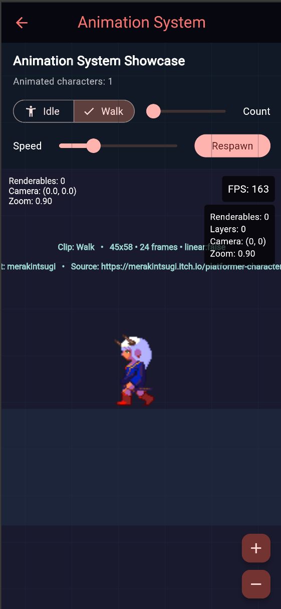
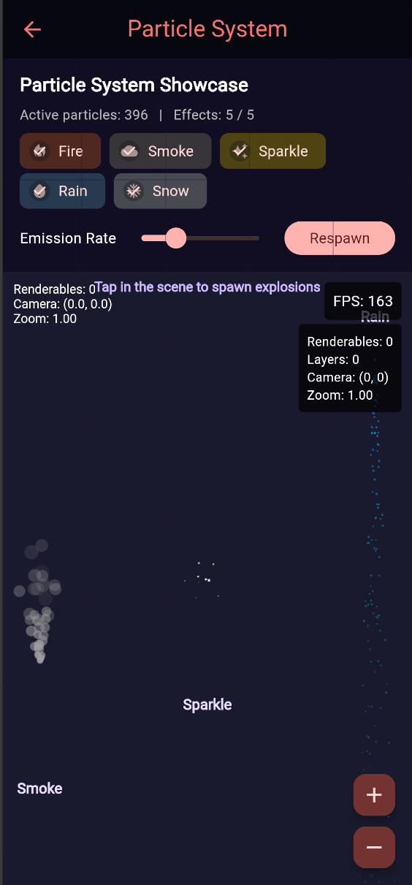
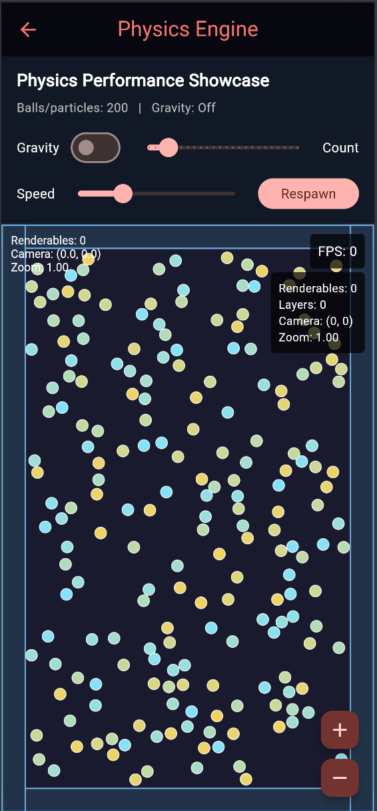
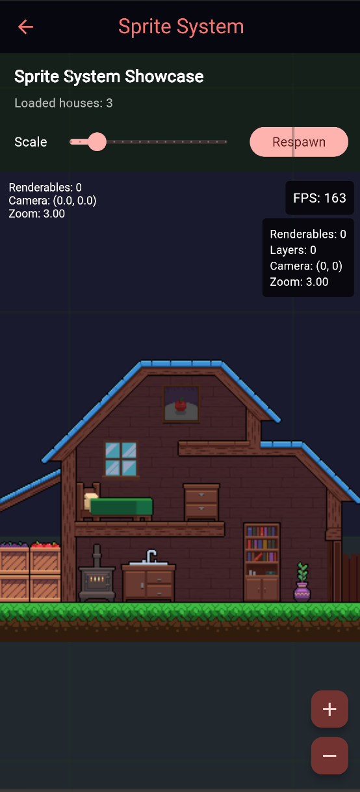
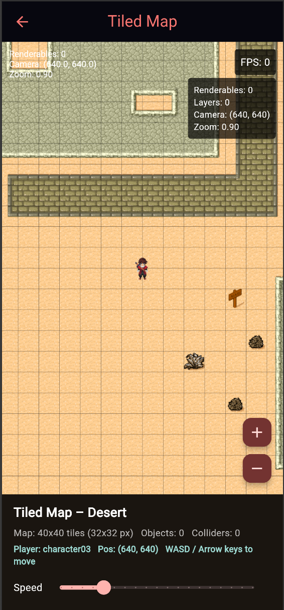

# Just Game Engine

A game engine for Flutter: 2D, with 3D graphics and physics to opt into. A game is entities, components and systems (ECS) in a `World`; its levels are JSON scenes loaded at runtime. The engine brings level maps, sprites and animator graphs, timelines, virtual cameras, physics, particles, audio and action-based input, and draws inside an ordinary Flutter widget. It runs on Android, iOS, Windows, macOS, Linux and the web (JavaScript or WebAssembly).

2.0.0 is a breaking release. Coming from 1.x? Read [MIGRATION.md](MIGRATION.md).

| Sprite animation | Particles | Physics | Sprites | Level maps |
|---|---|---|---|---|
|  |  |  |  |  |

## Install

```yaml
dependencies:
  just_game_engine: ^2.0.0
```

Needs Flutter 3.47.1 or newer (Dart 3.12).

## Quick start

```dart
import 'package:flutter/material.dart';
import 'package:just_game_engine/just_game_engine.dart';

Future<void> main() async {
  WidgetsFlutterBinding.ensureInitialized();

  // The engine, with its standard systems (see "Default systems").
  final engine = Engine(
    config: const EngineConfig(defaultSystems: DefaultSystems.all),
  );
  await engine.initialize();

  // A floor and a ball that falls onto it. y points down, and (0, 0) is
  // the middle of the screen until a virtual camera takes over.
  engine.world
    ..createEntityWithComponents([
      TransformComponent(position: Vector3(0, 200, 0)),
      RectangleComponent(width: 600, height: 24),
      // A collider alone is a static body; this one is the drawn rectangle.
      Collider2D(shape: ColliderShape2D.matchShape),
    ], name: 'Floor')
    ..createEntityWithComponents([
      TransformComponent(position: Vector3(0, -150, 0)),
      CircleComponent(radius: 24),
      RigidBody2D(),
      Collider2D(shape: ColliderShape2D.matchShape),
    ], name: 'Ball');

  engine.start();
  runApp(MaterialApp(home: GameWidget(engine: engine)));
}
```

- `Engine()` makes a new engine each time. `initialize()` builds its subsystems and world; finish it before using the engine. If a stage fails, it undoes what it built and throws an `EngineInitException`.
- `engine.start()` starts the game loop. `GameWidget` runs it on Flutter's frame ticker, draws the world, and passes keys and pointers to `engine.input`.
- When you are done, `await engine.dispose()`. Disposal is final: to start over, make a new `Engine()`.

[example/example.dart](example/example.dart) goes further: a level from scene JSON, input actions, a virtual camera and a system of the game's own.

## Loading a level

Levels are scene files: `assets/scenes/<name>.scene.json`, listed in play order in `assets/scenes/scenes.json`. Declare the folder under `assets:` in your `pubspec.yaml`.

```dart
Future<void> loadFirstLevel(Engine engine) async {
  final world = engine.world;
  final names = await SceneLoader.loadManifest(); // assets/scenes/scenes.json
  await SceneLoader.loadAsset(world, SceneAssets.pathFor(names.first));
  // Load the level's maps and tilesets before the first frame, so nothing
  // falls through ground whose collision is still loading.
  await LevelMaps.preload(world);
}
```

- A component in a scene is read through its `ComponentDefinition` in `engine.context`. The engine's own components are always known. A package's components are known once its `ContextExtension` is listed in `EngineConfig(extensions: [...])`. An unknown component type stops the load with an `UnknownComponentTypeException` naming the type and the entity.
- The current scene format is 9 (`SceneFormat.current`). Older files are migrated in memory as they load (`onMigrated` reports what changed); a file from a newer engine throws `UnsupportedFormatVersionException`.
- `SceneLoader.loadString` and `SceneLoader.load` take JSON text or a decoded map.

## Default systems

`EngineConfig.defaultSystems` is empty unless you set it, so a world starts with no systems. Each `DefaultSystem` adds:

| `DefaultSystem` | Systems |
|---|---|
| `input` | `InputSystem` (the `player` map's actions onto each `InputComponent`) |
| `physics` | `PhysicsSystem` |
| `movement` | `MovementSystem` |
| `audio` | `AudioSystem` |
| `rendering` | `RenderSystem`, `ParallaxRenderSystem` |
| `sprites` | `SpriteLoadSystem`, `AnimatorSystem`, `SpriteAnimationSystem`, `TimelineTriggerSystem`, `TimelineSystem` |
| `levelMaps` | `LevelMapSystem` |
| `mapCollision` | `MapCollisionSystem` |
| `cameras` | `CameraTargetGroupSystem`, `CameraTriggerSystem`, `CameraBrainSystem` |

`DefaultSystems.all` is every one; `DefaultSystems.headless` leaves out `rendering` and `audio` (for a server, a simulation or a test). `registerDefaultSystems(world, engine, include: ...)` adds them to any world and skips systems it already has, so a game can add its own configured instance first.

Add these yourself when you use them: `ParticleSystemECS`, `EffectSystemECS`, `PostProcessSystem`, `HealthSystem`, `LifetimeSystem`, `CheckpointSystem`, `RaycastSystem`, `DialogueSystem`, `PhysicsJointBindingSystem`, `ViewCullingSystem`. Systems run in priority order (`SystemPriorities`), not in the order they were added.

## Features

### World and scenes

- `World`, `Entity`, `Component`, `System`, with archetype storage and cached queries (`world.query`). `world.events` is a typed `EventBus`; `world.commands` defers changes made during an update; `EntityPrefab` and `world.instantiate` stamp out copies.
- Parents and children with a live transform hierarchy: a `ParentComponent` hangs an entity under another, and the world keeps the parent's `ChildrenComponent` in step. `TransformComponent.position` and `scale` are `Vector3`; `angle` is the 2-D turn.
- A `ComponentDefinition` describes a component's fields once, for saving, loading and editor inspectors. Each engine keeps its definitions, loaders and registries in its `EngineContext` (`engine.context`).
- Signal-based views of the ECS, on `just_signals`: `ComponentSignal`, `EntitySignal`, `WorldSignal`, `ReactiveSystem`.

### Level maps

- `LevelMapComponent`: a map of tile layers at its entity's position, saved in the scene, in its own `.map.json`, or read from a Tiled `.tmx` / `.tmj`. `TiledInterop` imports and exports Tiled maps and tilesets.
- Orthogonal, isometric, staggered and hexagonal maps (`MapGeometry`); animated, flipped and rotated tiles; layers that sort among the level's sprites, with parallax, tint and opacity.
- Collision from the tiles' shapes (`MapCollisionSystem`), with `solid` and `oneWay` built in and a game's own kinds in `MapCollisionKinds`.
- Entities on a map layer (`LayerComponent.mapLayer`) draw between that layer's tiles and the next layer's.
- Change tiles while the game runs: `LevelMaps.of(world, entity)` returns a `LevelMapHandle` (`setTile`, `setTerrain`); collision follows.
- Terrain painting with Wang sets (`WangFiller`), and a built-in tileset of basic shapes (`BuiltInTilesets.basicShapes`) to block out a level before there is art.

### Sprites and animation

- `SpriteComponent` for one image; `SpriteAnimationComponent` plays clips from an atlas; `AnimatorComponent` runs an `AnimatorGraph`, a state machine over clips driven by parameters.
- Atlases from TexturePacker (JSON array or hash, multi-page) and Aseprite (`SpriteAtlas`, `AtlasParser`); `SpriteBatch` draws many sprites of one atlas in one call.
- Shapes that draw themselves: `RectangleComponent`, `CircleComponent`, `CapsuleComponent`, `PolygonComponent`, `LineComponent`, styled with `ShapePaintStyle` and `ShapeGradient`.

### Timelines

- A `TimelineAsset` animates any saved component field with keyframes and curves, and plays sprite clips, camera shots, audio, activation, nested timelines and events.
- Play one with `TimelinePlayerComponent`; start one when something enters an area with `TimelineTriggerComponent`.

### Cameras

- A shot is an entity with a `VirtualCameraComponent`. The camera brain shows the enabled one with the highest priority and blends between shots.
- Components on the same entity shape the shot: framing with dead and soft zones (`CameraFramingComponent`), confining to bounds, noise, impulses, target groups, trigger areas, a dolly path, and state-driven, blend-list and mixer cameras.
- With no virtual camera in the world, `engine.cameraSystem.mainCamera` is yours to move.

```dart
void addCameras(Engine engine) {
  final world = engine.world;
  world.createEntityWithComponents([
    TransformComponent(),
    VirtualCameraComponent(follow: const EntityTarget.tag('player')),
    CameraFramingComponent(deadZoneWidth: 0.1, lookaheadTime: 0.25),
    CameraImpulseListenerComponent(),
  ], name: 'MainCamera');

  // Blend shots over 0.6 s, and shake the cameras that listen for impulses.
  engine.cameraSystem.brain
    ..defaultBlend = const CameraBlend(duration: 0.6)
    ..emitImpulse(CameraImpulse(position: Offset.zero, amplitude: 24));
}
```

### Physics

- The same model as 3-D (`package:just_game_engine/physics_3d.dart`), with a `2D` suffix: `RigidBody2D` is how a body moves (static, kinematic or dynamic; mass, friction, bounce, damping, gravity scale, sensor, layer and filter) and `Collider2D` its shape (box, circle, capsule, polygon, segment, chain, or *match shape*: whatever the entity draws; offset, rotation, one-way). A collider alone is a static body. `PhysicsSystem` steps `engine.physics` and syncs transforms and velocities back.
- Push a body from code with `addForce`, `addImpulse`, `addTorque`, `setVelocity` and the rest on `RigidBody2D`; it reports `isGrounded`, `groundNormal` and its velocities after each step.
- `CharacterBody2D` is a character gameplay moves instead (3-D's `CharacterBody3D`): set its `moveVelocity`, call `jump`, and it walks slopes, climbs steps, rides platforms and stands on one-way ones, the same on every platform. It needs no rigid body or collider.
- Physics comes from `just_physics_engine`: Box2D v3 through FFI where its native library loads, and a pure-Dart engine with the same API on the web or wherever it does not.
- Joints (`DistanceJoint2D`, `FixedJoint2D`, `SliderJoint2D`, `WheelJoint2D`), queries through `Physics2DQueries` (raycast, circle cast, overlaps, by layer), and ECS events: `CollisionEnter2DEvent`, `CollisionStay2DEvent` (opt in with `PhysicsSystem.reportContactStay`), `CollisionExit2DEvent`, `SensorEnter2DEvent`, `SensorExit2DEvent`. Some joint options wait on the physics engine; see the [known limitations](MIGRATION.md#known-limitations-in-200).


### 3-D graphics

```dart
import 'package:just_game_engine/graphics_3d.dart';

final engine = Engine(config: EngineConfig(graphics3D: Graphics3D()));
await engine.initialize();
await SceneLoader.loadAsset(engine.world, 'assets/scenes/level.scene.json');

// A perspective camera, in metres (+Y is down, so -Y is up).
engine.rendering.camera
  ..lens = const CameraLens.perspective(near: 0.1, far: 500)
  ..position = const Offset(0, -3)
  ..z = -8
  ..pitch = -0.36;
engine.start();
```

- `EngineConfig(graphics3D: Graphics3D())`, from `package:just_game_engine/graphics_3d.dart`, draws 3-D scenes with [just_graphics_engine](https://pub.dev/packages/just_graphics_engine) on Flutter GPU: `ModelComponent` (a `.glb` or `.gltf` model; its `bounds` fill in once it loads), `LightComponent` (directional, point or spot, shining along the entity's +Z; a scene with no lights gets a default sun), `EnvironmentComponent` (a gradient sky or an `.hdr` skybox, ambient light, reflections, fog, exposure), `AnimationPlayerComponent` (glTF clips with crossfades and blends; animator graphs and timelines play on a model's skeleton) and `SocketComponent` (pins a child entity to a joint).
- Eleven shapes made from their own sizes, no model file: `Cube3D`, `Sphere3D`, `Plane3D`, `Cylinder3D`, `Capsule3D`, `Cone3D`, `Torus3D`, `Ramp3D`, `Stairs3D`, `Arch3D` and `Polygon3D` (base `Primitive3D`), each with a material (colour, metallic, roughness, glow, opacity, unlit, a texture tiled per face or per metre). Equal shapes share a mesh and a material, so a hundred equal crates are one draw, and `Collider3D(shape: ColliderShape3D.matchShape)` gives one the same shape in 3-D physics.
- Bodies and characters moved by physics are drawn between their last two poses, so they move smoothly at any frame rate.
- Flutter GPU must be switched on in each platform's runner: see just_graphics_engine's README (Getting started).
- `engine.graphics3D` is the one given: its `renderer` (`renderer.stats` tells what the last frame did), `models` and `sceneRenderer` (`dynamicResolution`). `Graphics3D(renderScale: 0.75)` renders fewer pixels.
- A game without a `Graphics3D` is 2-D only: it makes no GPU device and loads no shaders, and a scene holding 3-D components fails to load, saying how to turn 3-D on. Where Flutter GPU can't draw (the web, Android without Vulkan) the game runs anyway: scenes and models load, the 3-D view shows a short note, `unsupportedReason` says why and `Graphics3D(onUnsupported: ...)` hears it.

### 3-D physics

- `EngineConfig(physics3D: Physics3D())`, from `package:just_game_engine/physics_3d.dart`: `RigidBody3D`, `Collider3D` (box, sphere, capsule, cylinder, convex hull, mesh, height field, or matching a 3-D shape), `CharacterBody3D` and six joints, simulated on Jolt Physics, with the same names, fields and events as 2-D (`3D` for `2D`).
- The app's pubspec builds Jolt:

  ```yaml
  hooks:
    user_defines:
      just_jolt:
        build: true
  ```

- A game without a `Physics3D` is 2-D only: its release build holds no 3-D code and no Jolt. The 3-D world is made with the first 3-D body. Where 3-D cannot run (the web, Jolt not built), `initialize()` fails with a `Physics3DUnsupportedError`; `Physics3D.isSupported` asks first.

### Particles, effects and post-processing

- `ParticleEmitter` with forces, sub-emitters and renderers; `ParticleEffects` has presets (explosion, fire, smoke, rain, snow, …). Put one on an entity with `ParticleEmitterComponent` and add `ParticleSystemECS`.
- Deterministic, tick-based effects (`MoveEffect`, `ScaleEffect`, `FadeEffect`, `ShakeEffect`, `SequenceEffect`, …) that serialize for networking and rollback; run by `EffectSystemECS`.
- Fragment-shader passes over the frame (`PostProcessPass`) and per entity (`ShaderComponent`). They need Impeller; on the web and on Skia they are skipped and the content draws unshaded.
- Parallax backgrounds: `ParallaxComponent`, drawn by `ParallaxRenderSystem`.

### Audio

- `engine.audio`, `engine.music` and `engine.sfx`, from `just_audio_engine`: channels, buses, effects, streams and 3-D sound. `AudioSourceComponent` and `AudioSystem` play sound from entities.
- On the web, audio starts at the first key or pointer press, because browsers keep audio made before a user gesture silent (`EngineConfig.deferAudioUntilInput`).

### Input

`engine.input` is an `InputService` from `just_inputs`: named actions bound to keyboard, mouse, gamepads and touch, read the same whatever the device. Actions and bindings live in an input asset (a `.input.json` file). It also handles local multiplayer (`PlayerInputManager`), rebinding with saved overrides, and on-screen touch controls.

```dart
Future<void> setUpInput(Engine engine) async {
  final text = await rootBundle.loadString('assets/input/game.input.json');
  engine.input.loadAsset(InputActionAsset.parse(text));
  await engine.input.attachGamepads(); // opt-in
}

// In a system of your own: InputSystem has copied the player's actions
// onto the entity's InputComponent, by name.
void control(Entity player) {
  final input = player.getComponent<InputComponent>()!;
  final velocity = player.getComponent<VelocityComponent>()!.velocity;
  velocity.x = input.vector('move').dx * 250; // y points down
  if (input.wasPressed('jump')) velocity.y = -600;
}
```

`rootBundle` comes from `package:flutter/services.dart`. The engine re-exports the parts of `just_inputs` a game uses at run time; the asset-building types (`InputActionDef`, …) and validation are in `package:just_inputs/just_inputs.dart`.

### Tags, targets and spawners

- An entity has any number of tags (`TagComponent`); `world.findTagged` and `world.allTagged` read an index instead of scanning.
- An `EntityTarget` points at an entity by name, by tag or at itself, so a camera or trigger in a level can name a player that is spawned later.
- A spawn point (`SpawnComponent`) names a `Spawner` the game provides; `SpawnPoints.spawnAll` calls the right one for every spawn point.
- A project's tags, colours and descriptions live in `assets/project/tags.json` (`TagLibrary`).

```dart
void spawnPlayers(World world, Entity Function(World, Entity) makePlayer) {
  final spawners = [
    Spawner(
      id: 'player',
      label: 'Player',
      tags: const {'player'}, // the tags makePlayer gives it, for editors
      spawn: makePlayer,
    ),
  ];
  SpawnPoints.spawnAll(world, spawners);
  final player = world.findTagged('player');
  player?.addTag('hero');
}
```

### In a Flutter app

- `GameWidget` hosts the game: FPS counter (`showFPS`), ECS debugger (`showDebug`), developer terminal (`showTerminal`, commands registered on `engine.terminal`), and an `overlay` for your own widgets.
- `engine.layers` (`GameLayers`) lets a package draw real Flutter widgets over every `GameWidget` showing the engine, with focus for text fields and menus. The `just_ui_editor` package draws its HUDs and menus this way.
- `package:just_game_engine/widgets.dart` has ready-made screen widgets: dialogue boxes, subtitles, localized text, camera zoom controls, on-screen touch controls and rebinding lists. Import it only if you use them.

### Also included

- Localization (`LocalizationManager`, set as `engine.context.localization`), with namespaces, fallbacks, plurals and selects.
- Dialogue from Yarn Spinner 2.x scripts (`DialogueManager`, `DialogueRunner`, `DialogueSystem`) and timed subtitles (`SubtitleController`).
- Assets (`engine.assets`, an `AssetManager`) and storage (`engine.cache`, a `CacheManager`); the engine keeps its data in a store of its own, apart from the app's.
- `EngineService`: things that start and stop with the engine (`EngineConfig.services`, `engine.service<T>()`). Plugins (`engine.plugins`, `EnginePlugin`) receive every update, for editors and profilers.
- `engine.performanceStats` and per-subsystem stats; see [STATS.md](STATS.md).

### Ready for 3-D

The engine's foundations do not assume 2-D: transforms have three axes and Euler rotations, a scene says whether it is `2d` or `3d` (`SceneMode`), cameras can use a perspective projection (`CameraProjection.perspective`) with frustum culling, and a `SceneRenderer` draws a scene beneath the 2-D world: `Graphics3D` draws 3-D through one (above).

### Web and WebAssembly

The library has no `dart:io` outside one conditional import, so a game builds for the web with JavaScript or WebAssembly. On the web, physics is pure Dart, audio waits for the first input, shaders are skipped (above), gamepads work in JavaScript builds only (`just_gamepads` has no WebAssembly backend yet), and 3-D scenes load but are not drawn (Flutter GPU is not on the web; the 3-D view says so).

## Upgrading from 1.x

The biggest changes; [MIGRATION.md](MIGRATION.md) covers every one.

- `Engine()` makes a new engine each call; `Engine.instance` is gone. `await engine.initialize()` before use; `dispose()` is async and final.
- Standard systems are opt-in: `EngineConfig(defaultSystems: DefaultSystems.all)`.
- Achievements, sign-in, leaderboards, currency, inventory and ads moved to the `just_game_services` package.
- Registries and loaders belong to each engine (`engine.context`), not to the process; packages install themselves with `EngineConfig.extensions`.
- Transforms are 3-D (`Vector3` position and scale; the 2-D turn is `angle`), cameras are virtual cameras, and input is `just_inputs` actions (`engine.input` is an `InputService`).
- UI widgets moved to `package:just_game_engine/widgets.dart`, and the re-exports of `just_inputs`, `just_dart`, `just_memory` and `just_audio_engine` are limited to what a game uses through the engine.
- Removed: the scene graph (`SceneEditor`, `Scene`, `SceneNode`), the tween animation system, the networking stub. Renamed: `AssetBundle` to `GameAssetBundle`, `Easing` to `EasingFunction`.

## Related packages

- [just_game_services](https://pub.dev/packages/just_game_services) (pub.dev): achievements, sign-in, leaderboards, currency, inventory and ads as opt-in `EngineService`s.
- `just_ui_editor` (not published): in-game screens saved as `.ui.json`, drawn as Flutter widgets, and their editor.
- `just_platformer_kit` (not published): platformer components and systems.
- `just_game_engine_editor` (not published): the level editor.

The engine is built on `just_physics_engine`, `just_graphics_engine`, `just_inputs`, `just_audio_engine`, `just_tiled`, `just_signals`, `just_memory`, `just_storage`, `just_database` and `just_dart`.

## Documentation

- [QUICKSTART.md](QUICKSTART.md): a first game, step by step.
- [MIGRATION.md](MIGRATION.md): upgrading from 1.x.
- [ARCHITECTURE.md](ARCHITECTURE.md): how the engine is put together.
- [ESP_ARCHITECTURE.md](ESP_ARCHITECTURE.md): a suggested app structure (Engine · Signal · Presentation).
- [CHANGELOG.md](CHANGELOG.md).
- [API map](https://github.com/just-unknown-dev/just-game-engine/blob/main/API.md): the public API by area (in the repository, not in the package).
- [API reference](https://pub.dev/documentation/just_game_engine/latest/).

## Links

- Website: <https://engine.justunknown.com/>
- Examples, written for 1.x: <https://examples.engine.justunknown.com> and <https://github.com/just-unknown-dev/just-game-engine-examples>
- Discord: <https://discord.gg/VXFxVj4Y>
- Issues: <https://github.com/just-unknown-dev/just-game-engine/issues>

## License

BSD-3-Clause; see [LICENSE](LICENSE).
